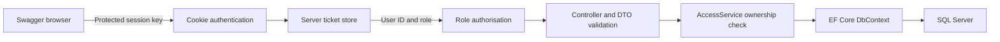

# RaceDay Part 2 demonstration guide

## How the request moves through the API

`Program.cs` registers dependencies and middleware. A request passes through safe exception handling, same-origin checks, routing, rate limiting, cookie authentication and authorisation, then reaches its controller. `WriteTransactionFilter` wraps writes in a serializable database transaction. DTO validation runs automatically under `[ApiController]`.

For a protected organiser write, trace this path:

## Authentication

Open `Controllers/AuthController.cs`. Registration normalises the email, validates the role, hashes the password using `IPasswordHasher<User>` and saves the user. Login verifies the hash and creates claims containing user ID and role. `Security/ServerTicketStore.cs` keeps the authentication ticket on the server. The cookie contains a protected random lookup key. `[Authorize]` checks a valid authenticated session. Logout removes the ticket; a copied old cookie then fails. Explain Secure/HttpOnly/SameSite cookie attributes, 30-minute expiry, and why HTTPS is required.

## EF Core and the database

Open `Models/Entities.cs`, `Data/RaceDayDbContext.cs` and the initial migration. C# entities represent rows, `DbSet<T>` represents a table, and foreign keys/navigation properties express relationships. Fluent configuration maps the Part 1 SQL lengths, decimal precision, SQL types and constraints. A migration records schema changes; `dotnet ef database update` applies them. Only the event types are seeded. `SaveChangesAsync` persists tracked changes using parameterised SQL. `AsNoTracking` is used for reads that do not change rows.

Show why the unique `(EventId, ParticipantId)` index prevents two enrolments in the same event even if two requests race. Show the unique Result.EnrolmentId index for one result per enrolment. Explain why a foreign key alone does not prove that the user is a Participant or that a category belongs to the selected event: the API enforces those rules.

## Roles and ownership

Open `Controllers/EventsController.cs`. `[Authorize(Roles = Roles.Organiser)]` rejects a Participant with 403. `AccessService.OwnedEvent` then checks that the event's OrganiserId equals the authenticated user ID; another Organiser also receives 403. A submitted organiser ID cannot override ownership because it is absent from the request DTO.

In `EnrolmentsController`, `OwnEnrolment` checks ParticipantId. The `/api/users/me/enrolments` and `/api/users/me/results` queries filter by the session user ID. A caller cannot request someone else's history by supplying an arbitrary user ID. `CategoryForEvent` rejects a category from another event.

## Controllers, DTOs and status codes

Controllers connect routes to application behaviour. DTOs specify permitted input fields; response projections hide hashes and avoid JSON navigation cycles. Services share the access rules. Explain 201 for creation, 200 for reads/updates, 204 for cancellation/logout, 400 for invalid fields, 401 for no valid session, 403 for wrong role/owner, 404 for missing resources and 409 for conflicts.

Open `Infrastructure/ErrorHandling.cs`: expected business errors become safe problem responses; unexpected errors are logged without leaking SQL, connection strings or stack traces to clients. Explain why serializable transactions matter to the event deletion check.

## Tests and what they prove

Run the test command and open the actual result report. `ValidationTests` are unit tests for rules such as invalid age bounds and finish-time limits. `AuthTests` and the other HTTP tests send real requests through the application and assert the observable status/data; they are integration tests. `PermissionTests` cover every protected route without login plus both cross-role directions. `ResultTests` advance `TestClock` rather than waiting for time to pass.

`DatabaseTests` attempt invalid direct EF writes, proving relational constraints independently of controller validation. SQLite makes the portable tests easy to run, but its type/length behaviour differs from SQL Server. Setting `RACEDAY_TEST_SQLSERVER` reruns the entire suite against actual SQL Server databases using the real migration. `SqlServerTests` verifies SQL-specific storage and length behaviour. Never describe a skipped SQL test as passed.

`AuthTests.Session_lifetime_uses_authentication_clock_and_expires_after_30_minutes` moves a separate session clock to prove expiry without sleeping. The re-login test proves that the new session works and the copied old cookie fails. The first real runs exposed an expiry-clock mismatch, retained re-login keys and a SQLite decimal check difference; fixes were committed and both CI jobs then passed. Be ready to explain how failing tests helped identify these defects.

## Suggested presentation order

1. Identify the development branch and show preserved Part 1 documents.
2. Explain the six-entity ERD and Code-First migration.
3. Register/login as an Organiser; create an event and category in Swagger.
4. Register/login as a Participant in another browser; enrol and show a duplicate 409.
5. Demonstrate wrong-role and wrong-owner 403 responses; show own profile/history.
6. Use a suitable completed-event demonstration record to capture/correct a result and show participant history.
7. Log out and show protected access returning 401.
8. Run tests and show the actual GitHub Actions results and meaningful commit history.
9. State known specification gaps and acknowledge AI assistance accurately.

Record the presentation yourself. Replace evidence placeholders only with your actual screenshots and video link.
